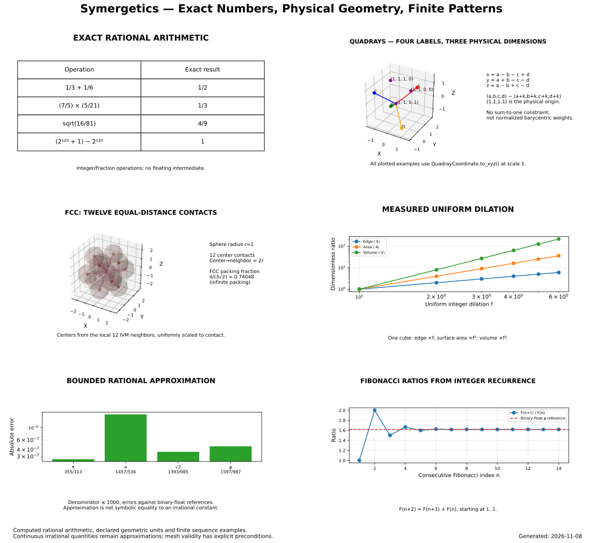

# Symergetics

Python implementation of Buckminster Fuller's Synergetics: exact rational
arithmetic, quadray/IVM coordinates, polyhedra, number-pattern experiments
(palindromes, primorials, scheherazade), and multi-backend visualization.
Paper pipeline under `paper/`; demo outputs under `output/`.

- Agents: start at [AGENTS.md](AGENTS.md) (orientation, verification commands).
- Current state: [STATUS.md](STATUS.md) · Backlog: [TODO.md](TODO.md)
- Documentation hub: [docs/index.md](docs/index.md)
- Quick check: see [Install and run](#install-and-run).

## Install and run

`symergetics` is not on PyPI. Choose a development checkout or a wheel
downloaded from [GitHub Releases](https://github.com/docxology/symergetics/releases).
Scientific work explicitly selects Python 3.13; do not change the repository's
`.python-version` pin just to run these commands.

From a checkout:

```bash
uv sync --python 3.13 --extra scientific
uv run --python 3.13 --extra scientific python -c "from symergetics import QuadrayCoordinate; print(QuadrayCoordinate(1, 0, 0, 0).to_xyz())"
```

NumPy is a required dependency of the core coordinate API. Scientific and test
tools remain available through their extras:

```bash
uv run --python 3.13 --extra scientific --extra test pytest tests/test_core_coordinates.py -q --no-cov
```

For the published [1.3.0 wheel](https://github.com/docxology/symergetics/releases/tag/1.3.0),
run in a separate directory/environment:

```bash
uv venv --python 3.13 .venv
uv pip install --python .venv/bin/python "symergetics[scientific] @ https://github.com/docxology/symergetics/releases/download/1.3.0/symergetics-1.3.0-py3-none-any.whl"
.venv/bin/python -I -c "import symergetics; print(symergetics.__version__)"
```

The same release page supplies the wheel and `SHA256SUMS` for a local-download
installation/provenance workflow. Do not run wheel consumer checks inside a
checkout where source imports could shadow the installed artifact. A release
wheel's API is fixed by that release; main docs can describe unreleased
features while metadata still reports version 1.3.0.

Start with the [tutorial](docs/tutorials/index.md) or [cookbook](docs/api-cookbook-recipes.md).

## Focused graphical abstracts on unreleased main

The existing `create_mega_graphical_abstract` API now has keyword-only
`section="overview"`: six readable default topics rather than all seventeen.
Use `geometry`, `arithmetic`, `patterns` or `all` for focused/full views.
The original three positional parameters remain supported; explicit titles
are preserved. Every section otherwise shares the primary output filename,
so pass separate paths to retain multiple views. This selector is **not
supported by the immutable 1.3.0 wheel**. See
[sections, output paths and metadata](docs/api/index.md#scientific-poster-sections-unreleased-main).



Solid graphical abstracts show declared indexed topology and distinguish exact
vertex means from uniform-solid mass centers. Native IVM volume, XYZ cubic
volume and floating surface area have different units; four quadray labels
represent rank-three geometry. See [the geometry contracts](docs/api/index.md#geometry-module),
not conceptual application prose, for implemented behavior.

## Synergetics suite

[QuadMath](https://github.com/docxology/QuadMath) provides the mathematical
specification, lattice algorithms and formalization;
[QuadCraft](https://github.com/docxology/QuadCraft) applies the geometry in
native and browser games. See the [suite guide](docs/synergetics-suite.md) for
coordinate/volume conventions and exact-data exchange boundaries.

The methods suite adds exact rational metrics, indexed live surface analysis,
uniform-solid mass centroids and even-odd multi-shell volumes. Area and
rendering use the same declared triangle fans. Plots retain local geometry at
huge translations; the scientific poster computes its arithmetic and sequences
instead of embedding stale test statistics. See the [API contracts](docs/api/index.md).

With sibling checkouts, Node.js and a C++17 compiler:

```bash
uv run --python 3.13 --extra scientific --extra test python examples/suite_interoperability.py
```

This exercises the actual implementations across all three projects; no
production package depends on a sibling checkout.

For the complete gate, first prepare QuadCraft's
[locked Chromium tooling](https://github.com/docxology/QuadCraft/blob/main/games/tests/browser/README.md),
then run from this repository:

```bash
python3 verify_suite.py --browser --report /tmp/synergetics-suite-receipt.json
```

This requires git, bash, `uv`, Node.js/npm, CMake and a C++17 compiler. It uses
frozen locks and temporary Python 3.13 environments/native builds without
replacing project environments. Receipts identify all three versions/revisions,
record dirty-source state, replace host paths with logical aliases, and retain
failed/unexecuted checks. Omit `--browser` for the explicitly labelled core
profile; use `--require-clean` for release verification.
See [release notes](CHANGELOG.md), the [suite workflow](.github/workflows/suite.yml)
and [package verification](.github/workflows/verify.yml).
