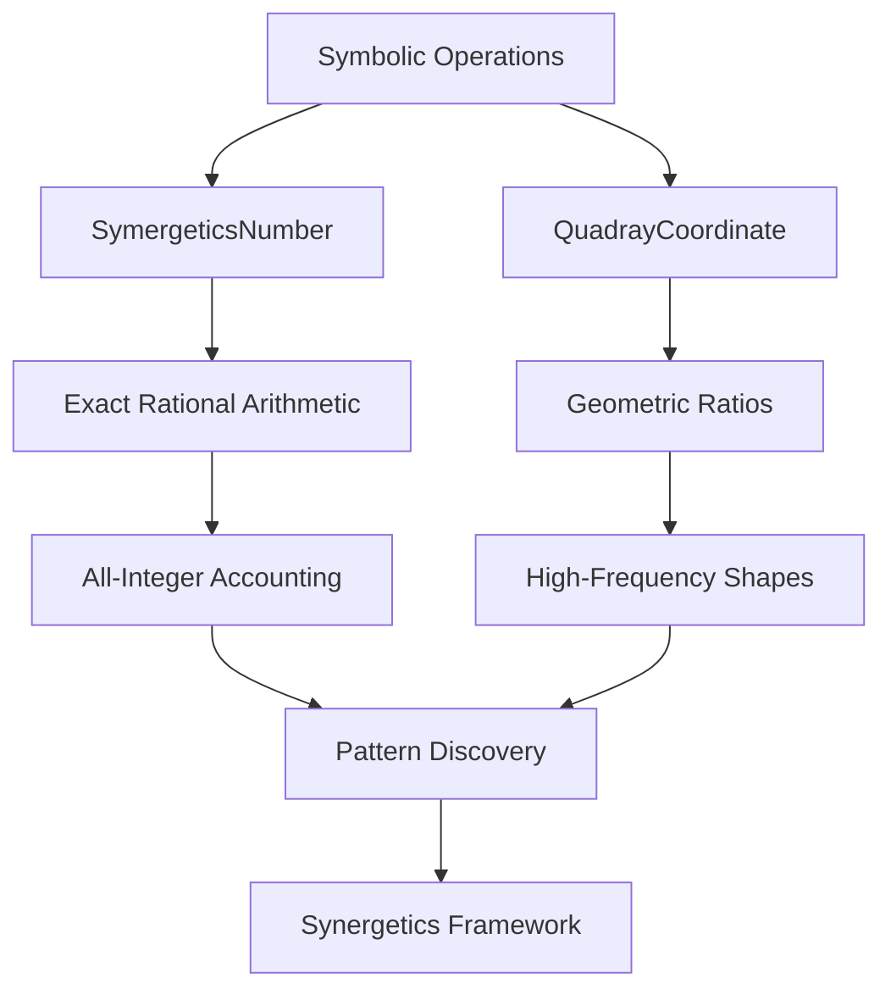
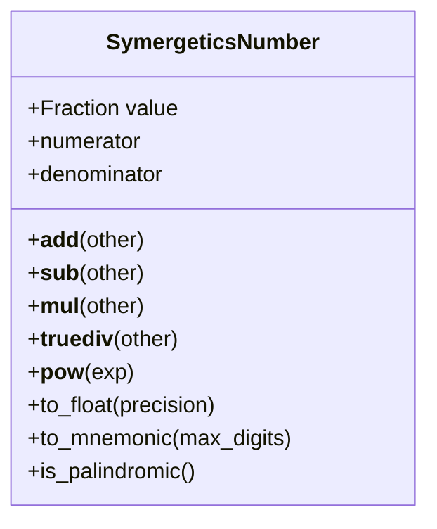
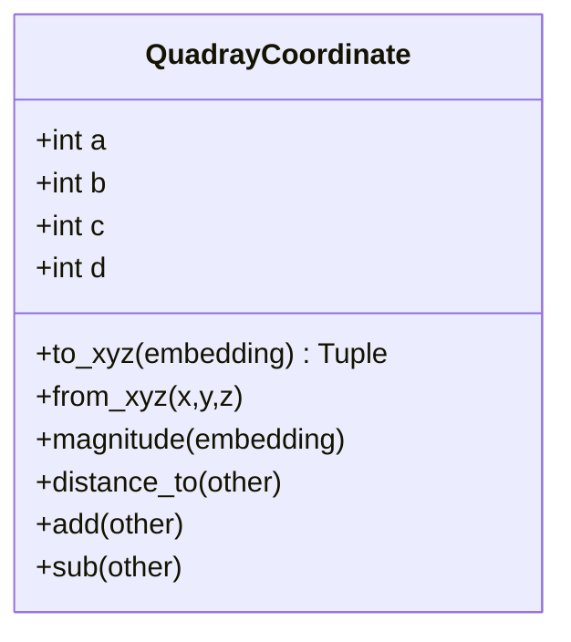
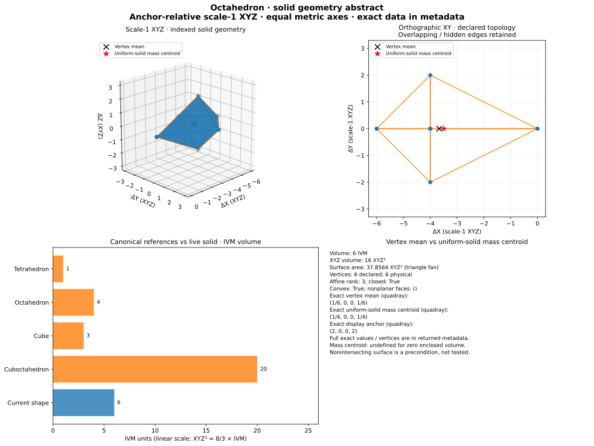
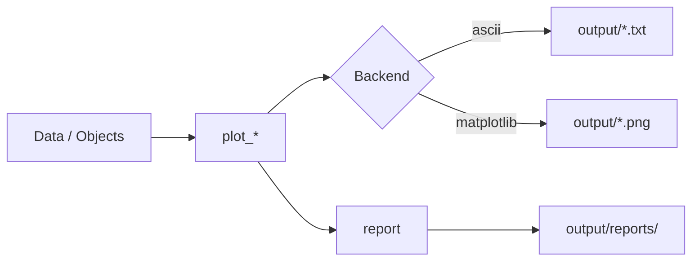

# API Reference

## Core Concept Integration

This reference describes the 1.4.0 source interface. Rational scalars, integer
quadray geometry, finite digit-pattern analysis and file-producing plots are
implemented; general cognitive, biological, quantum and cosmological models
are not installed APIs. See the [concept guide](../core-concept-guide.md)
and [checkout/release installation](../../README.md#install-and-run).

The keyword-only scientific-poster section selector was introduced in **1.4.0**;
earlier wheels retain their own release interfaces.

Declaration blocks describe signatures; they are not standalone executable
class definitions. Complete runnable consumer examples live in the
[cookbook](../api-cookbook-recipes.md).



## Core Module

### SymergeticsNumber

```python
class SymergeticsNumber:
    """Exact rational arithmetic for Synergetics."""

    def __init__(self, numerator, denominator=None)
    def __add__(self, other) -> SymergeticsNumber
    def __mul__(self, other) -> SymergeticsNumber
    def to_float(self, precision=None) -> float
    @classmethod
    def nth_root(cls, value, degree, max_denominator=1000000) -> SymergeticsNumber
    @classmethod
    def sqrt(cls, value, max_denominator=1000000) -> SymergeticsNumber
    def to_mnemonic(self, max_digits=50) -> str
    def is_palindromic(self) -> bool
```

**Key Methods:**

- Arithmetic: `+`, `-`, `*`, `/`, `**`
- Conversion: `to_float()`, `from_float()`
- Analysis: `is_palindromic()`, `to_mnemonic()`
- Properties: `numerator`, `denominator`

Integer exponents, including `Fraction(n, 1)`, remain exact. Rational powers
and `nth_root` preserve perfect rational roots without a float conversion,
including arbitrarily large integers and tiny fractions. Odd roots of negative
values are real; even roots of negative values raise `ValueError`. A negative
power of zero raises `ZeroDivisionError`.

Integral inputs and `Fraction` numerator/denominator fields are promoted to
unbounded Python integers before arithmetic, comparison, roots/powers and
coordinate snapping. This includes NumPy-backed fractions, whose fields would
otherwise retain fixed-width overflow behavior inside the standard class.

```python
from fractions import Fraction
from symergetics import SymergeticsNumber as N

assert N.sqrt(10**400).value == 10**200
assert N.nth_root(Fraction(-8, 27), 3).value == Fraction(-2, 3)
assert (N(-8) ** Fraction(1, 3)).value == -2
```

`degree` must be a positive integer. `max_denominator` bounds **approximations
only**; an exact perfect root may have a larger denominator. Irrational results
are finite-precision Decimal evaluations converted to bounded rational
approximations, not symbolic exact values or certified rounding bounds. Tiny
irrational results can approximate to zero. Float exponents retain their exact
binary-rational value: use `Fraction(1, 3)`, not `1/3`, for an exact cube-root
exponent.



### QuadrayCoordinate

```python
class QuadrayCoordinate:
    """Four-coordinate tetrahedral coordinate system."""

    def __init__(self, a, b, c, d, normalize=True)
    def to_xyz(self, embedding=None) -> Tuple[float, float, float]
    def magnitude(self, embedding=None) -> float
    def distance_to(self, other, embedding=None) -> float
    def dot_exact(self, other, embedding=None) -> Fraction
    def squared_norm_exact(self, embedding=None) -> Fraction
    def squared_distance_exact(self, other, embedding=None) -> Fraction
```

**Key Methods:**

- Conversion: `to_xyz()`, `from_xyz()`
- Operations: `add()`, `sub()`, `dot()`
- Properties: `as_tuple()`, `as_array()`

Components are integer lattice values. Integral and rational inputs are retained
exactly until rounding; nonintegral components use nearest-integer,
halves-away-from-zero rounding. `SymergeticsNumber` is a rational scalar type,
not a rational-coordinate representation.

`from_xyz` finds the spatially nearest integer quadray and resolves exact ties
by canonical tuple order. Custom embeddings must be finite, rank-three 3×4
matrices with the common-offset gauge in their kernel. `to_xyz` and `as_array`
are floating-point boundaries; they do not promise arbitrary-precision XYZ.

The default scale-one map is
`XYZ=(a-b-c+d, a+b-c-d, a-b+c-d)`. Its basis columns have length `sqrt(3)`,
not one. Common-offset aliases share a physical point, but equality and hashing
compare stored components. `add` and `sub` retain raw labels; normalize explicitly
when constructing canonical tuple identities. Do not mutate a coordinate while
it is a dictionary key or set member.

The full integer image is BCC; nearest projection is not restricted to FCC.
Exact-distance ties choose the lexicographically smallest minimum-zero tuple.
It differs from QuadMath's half-up inverse. A continuous pseudoinverse returned
by `geometry.transformations.xyz_to_quadray_matrix` is a different operation.

Exact metrics evaluate native integer combinations and rational embedding
coefficients before any floating boundary. Finite floats mean their exact
stored binary values. Floating dot products round completed expressions once;
norms use range-safe evaluation. This preserves resolved cancellation and
large common-offset aliases without promising arbitrary-precision XYZ output.



### Canonical IVM sites

```python
from symergetics.core.coordinates import enumerate_ivm_sites

sites = enumerate_ivm_sites(2)
assert len(sites) == 55
```

`size` is a nonnegative integer graph-shell radius about the origin under the
twelve IVM neighbor moves, not a raw four-index L1 cutoff. The returned tuple
contains unique min-zero coordinates with component sum divisible by four:
origin first, then lexicographically ordered sites within each shell.
Negative radii raise `ValueError`; noninteger radii raise `TypeError`.
This FCC enumeration is separate from nearest conversion on the full
integer-quadray image. Lattice plots and coordinate backgrounds use these same
physical sites and graph-radius semantics.


## Geometry Module

### Polyhedra Classes

`centroid_exact()` is the exact **declared vertex mean**, not generally the
uniform solid's center of mass. It returns a minimum-zero four-`Fraction`
tuple compatible with QuadMath. Empty input raises `ValueError`. The existing
`centroid()` remains floor-snapped and gauge-invariant; the rational mean
must not be reconstructed through the integer coordinate constructor.

`vertices` remains mutable. `volume()` calculates from the current vertices
rather than returning a stale cached value after a vertex replacement.

`with_vertices(vertices)` returns a same-concrete-type shallow copy without
rerunning its constructor. It owns a new vertex list; coordinate objects,
indexed topology and other state are retained by reference. Polyhedron scale,
reflection and coordinate transforms use this protocol. Subclasses with
geometry-dependent caches or different ownership must override it; it is not
a deep-copy guarantee.

### Indexed surfaces and live solid analysis

| Method | Contract |
|---|---|
| `face_indices()` | Stable cyclic vertex indices into the current mutable `vertices` sequence |
| `triangulated_faces()` | Declared polygon fans; the same surface used for measures and rendering |
| `surface_area(embedding=None)` | Floating area in the supplied XYZ metric; scaled accumulation retains recoverable subnormal totals |
| `volume_centroid_exact()` | Exact uniform-solid mass centroid as a canonical rational tuple; undefined for zero volume |
| `analyze_geometry()` | Live affine rank, physical vertex count, closure, nonplanar face indices, triangle-surface convexity, area, both volume units and both centroids |
| `to_xyz_vertices(embedding=None, *, relative_to=None)` | Optional displacement-first coordinates, avoiding large absolute-position cancellation |

Volume and solid moments require closed, orientable, non-self-intersecting
triangle surfaces. Nonintersecting disconnected shells add their masses;
nested shells use **even-odd enclosure**, subtracting cavities and restoring
islands. Self/mutual intersection is an input precondition, not a detection
claim. Nonplanar polygon faces use their declared triangle fan; nonplanarity
does not alone imply nonconvexity. Zero-volume analysis reports no solid
centroid instead of inventing a vertex-mean substitute.

```python
from fractions import Fraction
from symergetics.core.coordinates import QuadrayCoordinate
from symergetics.geometry.polyhedra import Cube

cube = Cube()
assert cube.surface_area() == 24
cube.vertices[0] = QuadrayCoordinate(2, 0, 0, 0)
analysis = cube.analyze_geometry()
assert analysis["volume_ivm"] == Fraction(9, 2)
assert analysis["volume_xyz"] == 12
assert analysis["is_convex"] and analysis["nonplanar_faces"] == (0, 2, 4)
assert cube.centroid_exact() == (Fraction(1, 8), 0, 0, 0)
assert cube.volume_centroid_exact() == (Fraction(1, 4), 0, 0, 0)
```

At default scale one, XYZ volume is `8/3` times native IVM volume.
See the [suite units and interoperability contract](../synergetics-suite.md).

At uniform embedding scale `s`, XYZ volume gains a factor `abs(s)**3` and area
a factor `s**2`; native IVM volume is unchanged. The default regular tetrahedron
has edge `2*sqrt(2)` whereas the default cube has edge `2`. Reference volume
ratios are not equal-edge claims. See the [derivation](../mathematical-foundations-synergetics.md).

#### Tetrahedron

```python
class Tetrahedron(SymergeticsPolyhedron):
    """Regular tetrahedron - volume = 1 IVM unit."""

    def volume(self) -> Fraction  # Default vertices: Fraction(1)
    def faces(self) -> List[List[QuadrayCoordinate]]
    def edges(self) -> List[Tuple[QuadrayCoordinate, QuadrayCoordinate]]
```

#### Octahedron

```python
class Octahedron(SymergeticsPolyhedron):
    """Regular octahedron - volume = 4 tetrahedra."""

    def volume(self) -> Fraction  # Default vertices: Fraction(4)
```

#### Cube

```python
class Cube(SymergeticsPolyhedron):
    """Cube - volume = 3 tetrahedra."""

    def volume(self) -> Fraction  # Default vertices: Fraction(3)
```

#### Cuboctahedron

```python
class Cuboctahedron(SymergeticsPolyhedron):
    """Vector equilibrium - volume = 20 tetrahedra."""

    def volume(self) -> Fraction  # Default vertices: Fraction(20)
```

### Volume Calculation Functions

```python
def integer_tetra_volume(p0, p1, p2, p3) -> Fraction
def ace_tetra_volume_5x5(p0, p1, p2, p3) -> Fraction
```

Import these functions from `symergetics.geometry.polyhedra`. Both return
`Fraction(abs(det), 4)`: a basis-corner tetrahedron has volume `1/4`, while the
regular unit IVM tetrahedron has volume `1`.

### Transformations

Import from `symergetics.geometry.transformations`:

- `scale(coord, factor)`: exact integer scaling; fractional factors scale in
  XYZ and project back to the integer lattice.
- `reflect(coord, axis)`: origin inversion, or reflection in the plane through
  the origin perpendicular to basis direction `a`, `b`, `c` or `d`, followed by
  lattice projection.
- `project_to_plane(coord, plane_normal, plane_point=None)`: exact rational
  Euclidean plane projection followed by one nearest-lattice snap. A finite
  nonzero three-vector normal is required; `plane_point` defaults to the origin.
  Finite Python and NumPy floating inputs mean their represented binary ratios.
  Snapping can move the result off the plane. `reflect` still accepts named
  axes, not an arbitrary-normal positional argument.
- `coordinate_transform(coord, matrix)`: a 4×4 linear transform whose row sums
  are equal, so it respects the common-offset gauge.
- `xyz_to_quadray_matrix(embedding=None)`: the continuous zero-sum minimum-norm
  4×3 inverse of the effective embedding (first three columns and their negative
  sum). Rational inversion retains anisotropic units until final float entries;
  this is neither exact nearest-lattice search nor a discrete inverse.

Quantized transformations need not preserve distances or be invertible.
See the [suite guide](../synergetics-suite.md) for embedding and volume units.

## Computation Module

### Primorial Calculations

```python
def primorial(n: int) -> SymergeticsNumber
def scheherazade_power(n: int) -> SymergeticsNumber
def cosmic_abundance_factors() -> Dict
```

`primorial(n)` multiplies primes at most `n`, not the first `n` primes.
`scheherazade_power(n)` computes `1001**n`. Both return `SymergeticsNumber`.
Import the additional helpers from
[`computation.primorials`](../../symergetics/computation/primorials.py), not the
package root. `scheherazade_pascal_coefficients(power)` returns a coefficient
list only when its three-digit blocks match without carries; an empty result
is not a missing proof to be filled with assumed coefficients.

### Palindrome Analysis

```python
def is_palindromic(number) -> bool
def extract_palindromic_patterns(number, min_length=3) -> List[str]
def find_palindromic_sequence(power: int) -> Dict
def analyze_scheherazade_ssrcd(power: int) -> Dict
```

## Utils Module

### Conversion Functions

```python
def rational_to_float(rational, precision=None) -> float
def float_to_exact_rational(value, max_denominator=1000000) -> SymergeticsNumber
def xyz_to_quadray(x, y, z) -> QuadrayCoordinate
def quadray_to_xyz(coord) -> Tuple[float, float, float]
def decimal_to_fraction(decimal_str: str) -> SymergeticsNumber
def best_rational_approximation(value: float, max_denominator=1000000) -> SymergeticsNumber
```

`decimal_to_fraction` preserves the supplied decimal string. Bounded rational
approximation functions approximate the supplied float, not an unknown intended
real value. Neither their names nor their rational return types certify an
original real constant as exact.

### Mnemonic Encoding

```python
def mnemonic_encode(number, style='raw') -> str
def format_large_number(number, grouping=3) -> str
def create_memory_aid(number) -> Dict[str, str]
def mnemonic_decode(mnemonic) -> Union[int, str]
def ungroup_number(grouped: str) -> int
```

Note on number formatting:

- Default representations across the project are ungrouped for symbolic workflows; use `format_large_number()` and `ungroup_number()` to transform as needed.
- Mnemonics are human-facing formatting, not numeric compression or a way to
  remove the memory/computation cost of a large integer.

## Constants

### Mathematical Constants

```python
from symergetics import SymergeticsConstants

assert SymergeticsConstants.VOLUME_RATIOS["tetrahedron"].value == 1
assert SymergeticsConstants.VOLUME_RATIOS["cube"].value == 3
assert SymergeticsConstants.SCHEHERAZADE_POWERS[2].value == 1002001
```

Reference ratios are stored in `VOLUME_RATIOS`; they are not module-level
`TETRAHEDRON_VOLUME`/`CUBE_VOLUME` aliases or replacements for live `volume()`.
The class also contains `SCHEHERAZADE_POWERS`, `PRIMORIALS`, `COSMIC_SCALING`,
`DIAMETER_TO_EDGE_RATIOS` and `IRRATIONAL_APPROXIMATIONS`.
Cosmic/reference numbers encode declared values, not independently validated
physical measurements or a cosmological simulation.

### Convenience Constants

```python
from symergetics.core.constants import PHI, PI, E, SQRT2, SQRT3, SCHEHERAZADE_BASE, COSMIC_ABUNDANCE
```

`PHI`, `PI`, `E`, `SQRT2` and `SQRT3` are rational **approximations** wrapped
as `SymergeticsNumber`, not exact symbolic irrationals. The other aliases are
declared integer/rational reference values. Inspect `.value` when exact
represented data, rather than rounded display, is required.

## Coordinate System Constants

### Predefined Coordinates

```python
from symergetics.core.coordinates import (
    ORIGIN, IVM_NEIGHBORS, TETRAHEDRON_VERTICES,
    OCTAHEDRON_VERTICES, CUBE_VERTICES,
)
```

These coordinate objects are mutable; copy before changing a reference model.
`IVM_NEIGHBORS` contains twelve permutations of `(2,1,1,0)` at scale-one
distance `2*sqrt(2)` from the origin.

## Visualization Module

High-level plotting API for geometry, numbers, and mathematical constructs.
Configured organized paths normally use `output/{category}/{subcategory}/`,
but backend/format support and fixed-layout behavior vary by function. Read
the returned `files` list instead of guessing names. Plot returns are
dictionaries, not live Matplotlib figures.

### Configuration

```python
from symergetics.visualization import (
    set_config, get_config, reset_config,
    ensure_output_dir, get_organized_output_path,
    create_output_structure_readme, list_output_structure,
    save_config, load_config,
)
```

Call `set_config({"output_dir": "/tmp/my-figures", "formats": ["png", "svg"],
"dpi": 120})` with one dictionary, not keyword arguments. `get_config()` is a
shallow copy; change nested settings through `set_config`, not by mutating
returned nested dictionaries. Configuration is process-global, not a
thread-local or request-local context.

Dimensions and DPI must be finite and positive. The 100,000,000 nominal-pixel
guard limits the requested canvas, not exact peak memory or final tight-bbox
dimensions. `formats` is not a promise that every plot emits every format:
polyhedron Matplotlib renderers save each configured non-HTML format through
Matplotlib (PNG/SVG are common); Plotly writes HTML and ASCII writes text.
Other geometry helpers may save a single primary file. Advanced poster output
is its explicit primary file. Restore prior configuration after application-owned
rendering.

### Geometry Visualizations

```python
from symergetics.visualization.geometry import (
    plot_polyhedron,
    plot_polyhedron_3d,
    plot_polyhedron_graphical_abstract,
    plot_polyhedron_wireframe,
    plot_quadray_coordinate,
    plot_ivm_lattice,
    plot_coordinate_transformation,
)
```

`plot_polyhedron` supports Matplotlib, Plotly and ASCII. Enhanced
`plot_polyhedron_3d` supports Matplotlib and Plotly; the solid graphical abstract
requires Matplotlib. Backend support is per function, not universal.
`plot_polyhedron_3d` applies elevation/azimuth and surface/wireframe visibility.
Polyhedron plots use an exact first-vertex-relative scale-one XYZ frame.
Metadata includes `coordinate_frame`, `origin_quadray_exact`,
`vertices_quadray_exact`, `declared_edges` and live `geometry_analysis`.
Values can include `Fraction` and tuples; this metadata is not automatically
JSON-serializable. Define an explicit exact-value serialization policy.

The solid abstract distinguishes vertex and uniform-solid centroids, canonical
reference volumes and the current shape. Its XY view is an orthographic
projection of declared edges, including hidden/overlapping ones, not a hull.
Huge exact labels are bounded honestly in the drawing while complete exact
values remain in metadata. `show_volume_ratios=False` and
`show_coordinates=False` remove the respective optional sections.
`show_edges`, `show_faces` and `show_vertices` control geometry layers; the XY
view has no filled faces. Animations consume the same declared triangle fans.

The solid abstract records `metadata.panels` as the enabled panel ID list:
`structure` and `xy_projection`, plus `volume_comparison` and/or `properties`
when enabled. It also records `projection`, `show_edges`, `show_faces`,
`show_vertices` and `reference_volumes_ivm_exact` (name/`Fraction` pairs; empty
when the reference-volume section is disabled). These are distinct from the
mega abstract's integer `metadata.panels` count.



This deliberately unequal-tip octahedron has native IVM volume 6, not the
canonical reference's 4. Display axes are anchor-relative scale-one XYZ;
full exact coordinates and both different centroid measurements remain in
metadata. The reference-volume bars do not replace live measurements.

Comparative/dashboard annotations use actual computed means, medians, summary
statistics and correlation coefficients, not literal formatting templates.
Constant-column correlations are undefined and shown as `N/A`; they are not
invented zero correlations. Rendering remains a floating presentation boundary,
not a domain-model validation or general statistical-inference interface.

### Scientific poster sections

Import from `symergetics.visualization.advanced`:

```python
from symergetics.visualization.advanced import create_mega_graphical_abstract

result = create_mega_graphical_abstract(
    output_path="/tmp/symergetics-geometry.png",
    backend="matplotlib",
    section="geometry",
)
```

The existing three positional parameters remain `title`, `output_path` and
`backend`. The new `section` argument is keyword-only. Omit `title` for a
section-specific title; explicit caller titles are preserved.

| `section` | Actual topic panels |
|---|---:|
| `"overview"` (default) | 6 |
| `"geometry"` | 6 |
| `"arithmetic"` | 6 |
| `"patterns"` | 5 |
| `"all"` | 17 |

The focused default is not the former all-17-panel overview. All panels use
computed arithmetic, scale-declared geometry or actual finite sequences;
irrational constants remain approximations and no panel is test-count evidence.
This API requires Matplotlib. Unsupported sections/backends raise `ValueError`;
undeclared keywords are not silently ignored.

With no explicit path, every section writes the same organized primary
`mathematical/mega_graphical_abstract/mega_graphical_abstract.png` under the
configured output root (subject to organization/timestamp settings). Different
sections can overwrite it: pass separate paths to keep multiple views. This
function does not batch-export all configured formats.

The result retains `files: list[str]` and `metadata` with type/title,
`panels` (integer count) and `dimensions`. Metadata also records `section`,
`panel_ids`, `panel_titles`, `figure_size_inches` and `dpi`. Top-level `data`
maps panel IDs to JSON-safe computed payloads; full exact rationals are strings.
Use those fields to identify what was actually selected, not an assumed layout.
The [real demo](../../examples/comprehensive_visualizations_demo.py) emits
separate modular outputs; see the [cookbook](../api-cookbook-recipes.md#scientific-poster-sections).

Section selection was introduced in **1.4.0**. Use its release wheel or the
corresponding checkout; 1.3.0 artifacts retain their earlier interface.

### Number Visualizations

```python
from symergetics.visualization.numbers import (
  plot_palindromic_pattern,
  plot_scheherazade_pattern,
  plot_primorial_distribution,
  plot_mnemonic_visualization
)
```

### Mathematical Visualizations

```python
from symergetics.visualization.mathematical import (
  plot_continued_fraction,
  plot_base_conversion,
  plot_pattern_analysis,
  plot_ssrcd_analysis
)
```

`plot_base_conversion(number, from_base=10, to_base=2, ...)` interprets the
supplied signed digit spelling in `from_base` (bases 2–36; base 10 requires an
integer), rather than plotting a decimal surrogate. Returned coefficients and descending place weights
reconstruct the decoded value; binary coefficients are most-significant-first.

`plot_pattern_analysis(number, pattern_type="palindrome", backend=None, *,
include_matrix=True, **kwargs)` preserves raw decimal leading zeros. Its
off-diagonal matrix relates endpoints of contiguous palindromes of length at
least two, equal-digit positions for `repeated`, or equal whole-sequence
mirror pairs for `symmetric`. The coverage vector marks participating positions;
it is not a palindrome-count density.

The dense `pattern_matrix` remains the default on every backend and has
quadratic output size. Explicit `backend="ascii", include_matrix=False` opts
into linear text analysis and returns `pattern_matrix=None`; Matplotlib and
Plotly reject matrix omission before writing an artifact. Radar palindrome
coverage uses linear-time scalar analysis without a dense matrix, with no
arbitrary input cap. The computation module's odd-center palindromic density
is a separate metric. Continued-fraction errors, primorial values, SS-RCD
quantities and radar scores derive from the supplied numeric data.

Radar axes are dimensionless fractions: distinct digits divided by ten,
entropy divided by `log2(10)`, repeated-digit and repeated-bigram occurrence
membership, contiguous-palindrome coverage and equal whole-sequence mirror
pairs. Raw entropy remains separately reported in bits per digit. These
fractions are not raw counts clipped to fit a radial range.

Renderers close their own Matplotlib figures after saves and failures, not
pre-existing caller figures. Unsupported backends raise rather than silently
falling back.

Scientific footer dates honor the UTC date of `SOURCE_DATE_EPOCH` when set,
otherwise the current local date. Demo JSON sidecars use paths relative to the sidecar directory; neither
this date convention nor relative paths guarantee universal byte identity.

### Batch and Export

```python
from symergetics.visualization import (
  batch_visualize,
  create_animation,
  export_visualization,
  batch_process,
  create_visualization_report
)
```



## Error Handling

The package uses standard Python exceptions:

- `ValueError`: Invalid input parameters
- `ZeroDivisionError`: Division by zero
- `TypeError`: Incorrect type usage

## Performance Notes

- Rational scalar arithmetic and integer determinant volumes are exact.
- XYZ output, rotations and continuous inverse entries have floating boundaries;
  plane operations use exact represented rational arithmetic before a single
  nearest-lattice snap. Quantization remains distinct from floating roundoff.
- Core coordinates require NumPy; visualization/scientific backends use extras.
- Volume calculations use integer determinant methods

## Thread Safety

There is no package-wide thread-safety guarantee. Coordinates, vertex lists
and visualization configuration are mutable; rendering has backend-specific
global state. Isolate concurrent application work and avoid shared mutations.
