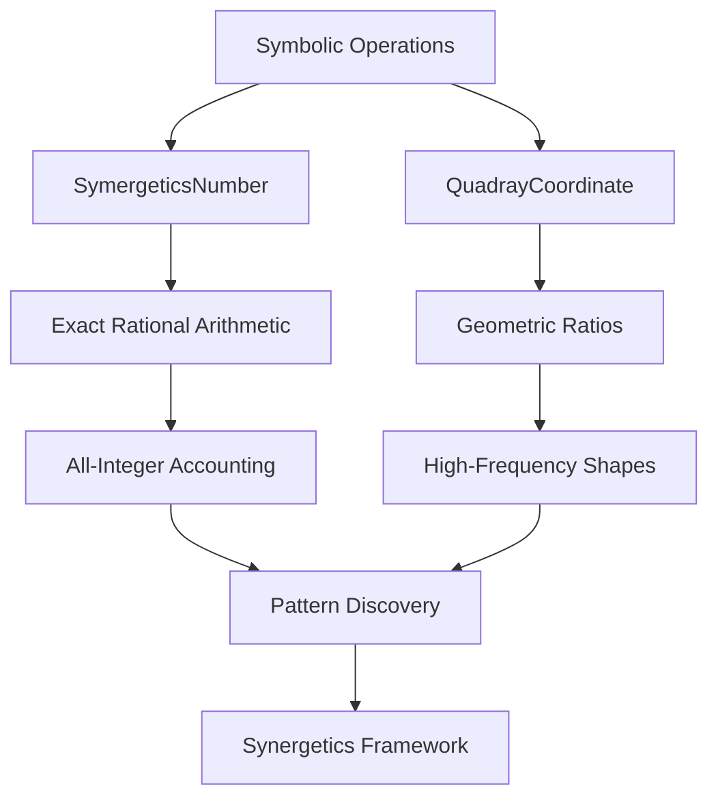
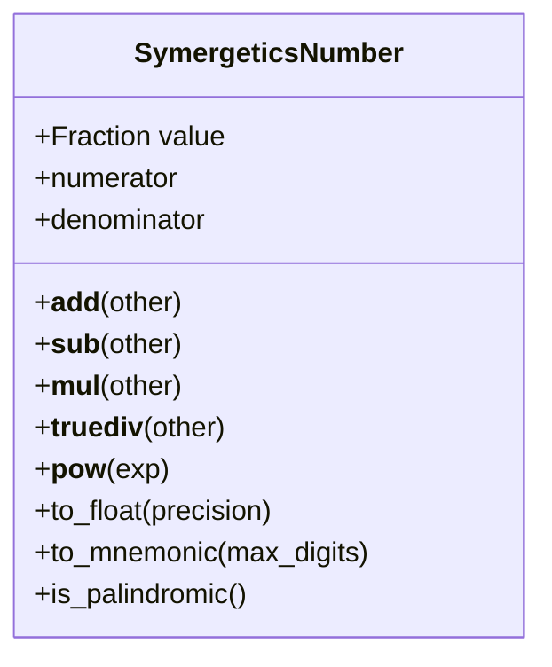
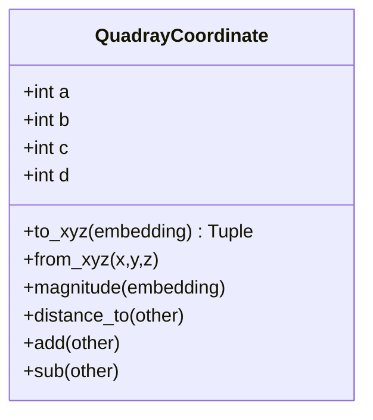
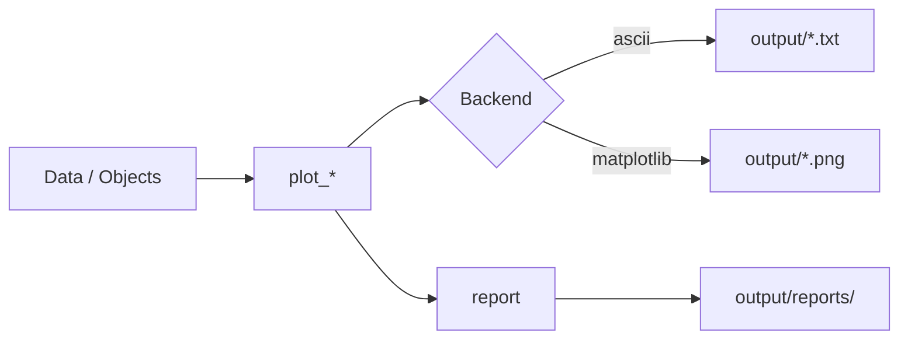

# API Reference

## Core Concept Integration

The API is designed around the core concept of **symbolic operations on all-integer accounting based upon ratios (geometrically based upon high frequency shapes) of the Synergetics geometry and Quadray/4D coordinates**. Each component contributes to this unified approach:

- **SymergeticsNumber**: Enables symbolic operations and all-integer accounting
- **QuadrayCoordinate**: Provides geometric ratios through high-frequency shapes
- **Synergetics Geometry**: Implements the comprehensive geometric framework
- **Computation Modules**: Apply exact ratios to advanced mathematical patterns



## Core Module

### SymergeticsNumber

```python
class SymergeticsNumber:
    """Exact rational arithmetic for Synergetics."""

    def __init__(self, numerator, denominator=1)
    def __add__(self, other) -> SymergeticsNumber
    def __mul__(self, other) -> SymergeticsNumber
    def to_float(self, precision=None) -> float
    @classmethod
    def nth_root(cls, value, degree, max_denominator=1000000) -> SymergeticsNumber
    @classmethod
    def sqrt(cls, value, max_denominator=1000000) -> SymergeticsNumber
    def to_mnemonic(self) -> str
    def is_palindromic() -> bool
```

**Key Methods:**

- Arithmetic: `+`, `-`, `*`, `/`, `**`
- Conversion: `to_float()`, `from_float()`
- Analysis: `is_palindromic()`, `to_mnemonic()`
- Properties: `numerator`, `denominator`

Integer exponents, including `Fraction(n, 1)`, remain exact. Rational powers
and `nth_root` preserve perfect rational roots without a float conversion,
including arbitrarily large integers and tiny fractions. Odd roots of negative
values are real; even roots of negative values raise `ValueError`. A negative
power of zero raises `ZeroDivisionError`.

Integral inputs and `Fraction` numerator/denominator fields are promoted to
unbounded Python integers before arithmetic, comparison, roots/powers and
coordinate snapping. This includes NumPy-backed fractions, whose fields would
otherwise retain fixed-width overflow behavior inside the standard class.

```python
from fractions import Fraction
from symergetics import SymergeticsNumber as N

assert N.sqrt(10**400).value == 10**200
assert N.nth_root(Fraction(-8, 27), 3).value == Fraction(-2, 3)
assert (N(-8) ** Fraction(1, 3)).value == -2
```

`degree` must be a positive integer. `max_denominator` bounds **approximations
only**; an exact perfect root may have a larger denominator. Irrational results
are finite-precision Decimal evaluations converted to bounded rational
approximations, not symbolic exact values or certified rounding bounds. Tiny
irrational results can approximate to zero. Float exponents retain their exact
binary-rational value: use `Fraction(1, 3)`, not `1/3`, for an exact cube-root
exponent.



### QuadrayCoordinate

```python
class QuadrayCoordinate:
    """Four-coordinate tetrahedral coordinate system."""

    def __init__(self, a, b, c, d, normalize=True)
    def to_xyz(self, embedding=None) -> Tuple[float, float, float]
    def magnitude(self, embedding=None) -> float
    def distance_to(self, other, embedding=None) -> float
    def dot_exact(self, other, embedding=None) -> Fraction
    def squared_norm_exact(self, embedding=None) -> Fraction
    def squared_distance_exact(self, other, embedding=None) -> Fraction
```

**Key Methods:**

- Conversion: `to_xyz()`, `from_xyz()`
- Operations: `add()`, `sub()`, `dot()`
- Properties: `as_tuple()`, `as_array()`

Components are integer lattice values. Integral and rational inputs are retained
exactly until rounding; nonintegral components use nearest-integer,
halves-away-from-zero rounding. `SymergeticsNumber` is a rational scalar type,
not a rational-coordinate representation.

`from_xyz` finds the spatially nearest integer quadray and resolves exact ties
by canonical tuple order. Custom embeddings must be finite, rank-three 3×4
matrices with the common-offset gauge in their kernel. `to_xyz` and `as_array`
are floating-point boundaries; they do not promise arbitrary-precision XYZ.

Exact metrics evaluate native integer combinations and rational embedding
coefficients before any floating boundary. Finite floats mean their exact
stored binary values. Floating dot products round completed expressions once;
norms use range-safe evaluation. This preserves resolved cancellation and
large common-offset aliases without promising arbitrary-precision XYZ output.



### Canonical IVM sites

```python
from symergetics.core.coordinates import enumerate_ivm_sites

sites = enumerate_ivm_sites(2)
assert len(sites) == 55
```

`size` is a nonnegative integer graph-shell radius about the origin under the
twelve IVM neighbor moves, not a raw four-index L1 cutoff. The returned tuple
contains unique min-zero coordinates with component sum divisible by four:
origin first, then lexicographically ordered sites within each shell.
Negative radii raise `ValueError`; noninteger radii raise `TypeError`.
This FCC enumeration is separate from nearest conversion on the full
integer-quadray image. Lattice plots and coordinate backgrounds use these same
physical sites and graph-radius semantics.


## Geometry Module

### Polyhedra Classes

`centroid_exact()` is the exact **declared vertex mean**, not generally the
uniform solid's center of mass. It returns a minimum-zero four-`Fraction`
tuple compatible with QuadMath. Empty input raises `ValueError`. The existing
`centroid()` remains floor-snapped and gauge-invariant; the rational mean
must not be reconstructed through the integer coordinate constructor.

`vertices` remains mutable. `volume()` calculates from the current vertices
rather than returning a stale cached value after a vertex replacement.

### Indexed surfaces and live solid analysis

| Method | Contract |
|---|---|
| `face_indices()` | Stable cyclic vertex indices into the current mutable `vertices` sequence |
| `triangulated_faces()` | Declared polygon fans; the same surface used for measures and rendering |
| `surface_area(embedding=None)` | Floating area in the supplied XYZ metric; scaled accumulation retains recoverable subnormal totals |
| `volume_centroid_exact()` | Exact uniform-solid mass centroid as a canonical rational tuple; undefined for zero volume |
| `analyze_geometry()` | Live affine rank, physical vertex count, closure, nonplanar face indices, triangle-surface convexity, area, both volume units and both centroids |
| `to_xyz_vertices(embedding=None, relative_to=None)` | Optional displacement-first coordinates, avoiding large absolute-position cancellation |

Volume and solid moments require closed, orientable, non-self-intersecting
triangle surfaces. Nonintersecting disconnected shells add their masses;
nested shells use **even-odd enclosure**, subtracting cavities and restoring
islands. Self/mutual intersection is an input precondition, not a detection
claim. Nonplanar polygon faces use their declared triangle fan; nonplanarity
does not alone imply nonconvexity. Zero-volume analysis reports no solid
centroid instead of inventing a vertex-mean substitute.

```python
from fractions import Fraction
from symergetics.core.coordinates import QuadrayCoordinate
from symergetics.geometry.polyhedra import Cube

cube = Cube()
assert cube.surface_area() == 24
cube.vertices[0] = QuadrayCoordinate(2, 0, 0, 0)
analysis = cube.analyze_geometry()
assert analysis["volume_ivm"] == Fraction(9, 2)
assert analysis["volume_xyz"] == 12
assert analysis["is_convex"] and analysis["nonplanar_faces"] == (0, 2, 4)
assert cube.centroid_exact() == (Fraction(1, 8), 0, 0, 0)
assert cube.volume_centroid_exact() == (Fraction(1, 4), 0, 0, 0)
```

At default scale one, XYZ volume is `8/3` times native IVM volume.
See the [suite units and interoperability contract](../synergetics-suite.md).

#### Tetrahedron

```python
class Tetrahedron(SymergeticsPolyhedron):
    """Regular tetrahedron - volume = 1 IVM unit."""

    def volume(self) -> Fraction  # Default vertices: Fraction(1)
    def faces(self) -> List[List[QuadrayCoordinate]]
    def edges(self) -> List[Tuple[QuadrayCoordinate, QuadrayCoordinate]]
```

#### Octahedron

```python
class Octahedron(SymergeticsPolyhedron):
    """Regular octahedron - volume = 4 tetrahedra."""

    def volume(self) -> Fraction  # Default vertices: Fraction(4)
```

#### Cube

```python
class Cube(SymergeticsPolyhedron):
    """Cube - volume = 3 tetrahedra."""

    def volume(self) -> Fraction  # Default vertices: Fraction(3)
```

#### Cuboctahedron

```python
class Cuboctahedron(SymergeticsPolyhedron):
    """Vector equilibrium - volume = 20 tetrahedra."""

    def volume(self) -> Fraction  # Default vertices: Fraction(20)
```

### Volume Calculation Functions

```python
def integer_tetra_volume(p0, p1, p2, p3) -> Fraction
def ace_tetra_volume_5x5(p0, p1, p2, p3) -> Fraction
```

Import these functions from `symergetics.geometry.polyhedra`. Both return
`Fraction(abs(det), 4)`: a basis-corner tetrahedron has volume `1/4`, while the
regular unit IVM tetrahedron has volume `1`.

### Transformations

Import from `symergetics.geometry.transformations`:

- `scale(coord, factor)`: exact integer scaling; fractional factors scale in
  XYZ and project back to the integer lattice.
- `reflect(coord, axis)`: origin inversion, or reflection in the plane through
  the origin perpendicular to basis direction `a`, `b`, `c` or `d`, followed by
  lattice projection.
- `coordinate_transform(coord, matrix)`: a 4×4 linear transform whose row sums
  are equal, so it respects the common-offset gauge.
- `xyz_to_quadray_matrix(embedding=None)`: the supplied embedding's continuous
  4×3 pseudoinverse, not a discrete lattice inverse.

Quantized transformations need not preserve distances or be invertible.
See the [suite guide](../synergetics-suite.md) for embedding and volume units.

## Computation Module

### Primorial Calculations

```python
def primorial(n: int) -> SymergeticsNumber
def scheherazade_power(n: int) -> SymergeticsNumber
def cosmic_abundance_factors() -> Dict
```

### Palindrome Analysis

```python
def is_palindromic(number) -> bool
def extract_palindromic_patterns(number, min_length=3) -> List[str]
def find_palindromic_sequence(power: int) -> Dict
def analyze_scheherazade_ssrcd(power: int) -> Dict
```

## Utils Module

### Conversion Functions

```python
def rational_to_float(rational, precision=None) -> float
def float_to_exact_rational(value, max_denominator=1000000) -> SymergeticsNumber
def xyz_to_quadray(x, y, z) -> QuadrayCoordinate
def quadray_to_xyz(coord) -> Tuple[float, float, float]
def decimal_to_fraction(decimal_str: str) -> SymergeticsNumber
def best_rational_approximation(value: float, max_denominator=1000000) -> SymergeticsNumber
```

### Mnemonic Encoding

```python
def mnemonic_encode(number, style='grouped') -> str
def format_large_number(number, grouping=3) -> str
def create_memory_aid(number) -> Dict[str, str]
def mnemonic_decode(mnemonic) -> Union[int, str]
def ungroup_number(grouped: str) -> int
```

Note on number formatting:

- Default representations across the project are ungrouped for symbolic workflows; use `format_large_number()` and `ungroup_number()` to transform as needed.

## Constants

### Mathematical Constants

```python
# Volume ratios
TETRAHEDRON_VOLUME = 1
OCTAHEDRON_VOLUME = 4
CUBE_VOLUME = 3
CUBOCTAHEDRON_VOLUME = 20

# Scheherazade numbers
SCHEHERAZADE_BASE = 1001
SCH_1 = 1001
SCH_2 = 1002001
SCH_6 = 1006015020015006001  # Contains Pascal's triangle

# Cosmic scaling
ATOMIC_DIAMETERS_PER_INCH = 25_000_000_000
EARTH_CIRCUMFERENCE_SECONDS = 1_296_000
EARTH_CIRCUMFERENCE_DEGREES = 360
```

### Convenience Constants

```python
PHI = (1 + √5) / 2  # Golden ratio
PI = π              # π
E = e               # Euler's number
SQRT2 = √2          # Square root of 2
SQRT3 = √3          # Square root of 3
```

## Coordinate System Constants

### Predefined Coordinates

```python
ORIGIN = QuadrayCoordinate(0, 0, 0, 0)
IVM_NEIGHBORS = [QuadrayCoordinate(2,1,1,0), ...]  # 12-around-one
TETRAHEDRON_VERTICES = [...]  # Unit tetrahedron vertices
OCTAHEDRON_VERTICES = [...]   # Regular octahedron vertices
CUBE_VERTICES = [...]         # Cube vertices
```

## Visualization Module

High-level plotting API for geometry, numbers, and mathematical constructs.
Configured outputs use `output/{category}/{subcategory}/`. The mega abstract
has its own fixed poster layout rather than inheriting the ordinary figure size.

### Configuration

```python
from symergetics.visualization import (
    set_config, get_config, reset_config,
    ensure_output_dir, get_organized_output_path,
    create_output_structure_readme, list_output_structure,
    save_config, load_config,
)
```

### Geometry Visualizations

```python
from symergetics.visualization.geometry import (
    plot_polyhedron,
    plot_polyhedron_3d,
    plot_polyhedron_graphical_abstract,
    plot_polyhedron_wireframe,
    plot_quadray_coordinate,
    plot_ivm_lattice,
    plot_coordinate_transformation,
)
```

`plot_polyhedron_3d` applies elevation/azimuth and surface/wireframe visibility
to both actual backends. Polyhedron plots use an anchor-relative XYZ frame;
metadata includes `coordinate_frame`, `origin_quadray_exact` and live
`geometry_analysis`. Equal spans and unit box aspect preserve physical lengths.
Graphical abstracts distinguish vertex and solid centroids and canonical
reference volumes from the live shape. Animations consume the same indexed
triangle fans and record exact frame origins.

The advanced `create_mega_graphical_abstract(title, output_path, backend)`
renders computed rational arithmetic, actual finite sequences, scale-declared
geometry and numerical-boundary examples. It does not embed test/coverage
statistics or substitute synthetic curves for computed data. Irrational
constants remain approximations. Only its declared arguments are accepted;
previously ignored extra keywords are no longer silently swallowed.

### Number Visualizations

```python
from symergetics.visualization.numbers import (
  plot_palindromic_pattern,
  plot_scheherazade_pattern,
  plot_primorial_distribution,
  plot_mnemonic_visualization
)
```

### Mathematical Visualizations

```python
from symergetics.visualization.mathematical import (
  plot_continued_fraction,
  plot_base_conversion,
  plot_pattern_analysis,
  plot_ssrcd_analysis
)
```

### Batch and Export

```python
from symergetics.visualization import (
  batch_visualize,
  create_animation,
  export_visualization,
  batch_process,
  create_visualization_report
)
```



## Error Handling

The package uses standard Python exceptions:

- `ValueError`: Invalid input parameters
- `ZeroDivisionError`: Division by zero
- `TypeError`: Incorrect type usage

## Performance Notes

- Rational scalar arithmetic and integer determinant volumes are exact.
- XYZ conversion and continuous transforms use floating point; lattice
  projection introduces discrete quantization.
- Core coordinates require NumPy; visualization/scientific backends use extras.
- Volume calculations use integer determinant methods

## Thread Safety

All classes and functions are thread-safe for read operations. Write operations to shared state are not recommended in multi-threaded environments.
