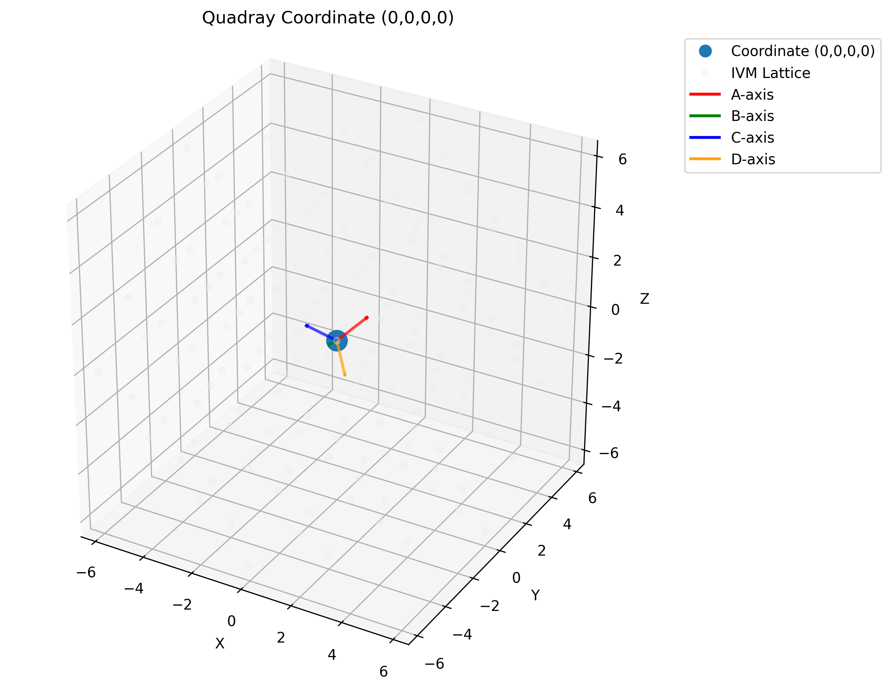
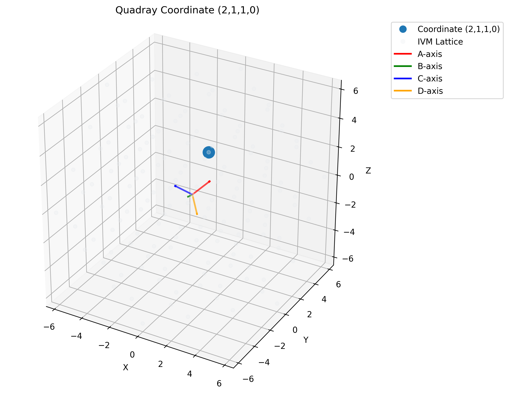

## Mathematical Foundations

### The Synergetics Framework

Fuller and Applewhite's [Synergetics](https://www.rwgrayprojects.com/synergetics/)
is historical context for ratio-based geometric exploration. This manuscript
uses explicit mathematical definitions; philosophical claims about universal
natural patterns are not empirical conclusions of the software.

### Exact Rational Arithmetic

`SymergeticsNumber` is a wrapper around `fractions.Fraction`, not its subclass.
Rational addition, subtraction, multiplication, nonzero division and integer
powers preserve rational values. Reduced fractions represent the same exact
number; 3/4 + 1/6 = 11/12.

A float constructor preserves the float's binary rational value; `from_float`
approximates it with a bounded denominator. Perfect rational roots stay exact;
irrational roots and powers are approximated. `PI`, `E` and `PHI` are rational
approximations, not exact transcendental or algebraic values. See
[numbers.py](../../symergetics/core/numbers.py) and
[constants.py](../../symergetics/core/constants.py).

### Quadray Coordinate System

Four components q = (a,b,c,d) encode three-dimensional positions modulo
q ~ q + k(1,1,1,1). Subtracting the minimum selects a nonnegative, minimum-zero
representative; it does not impose a zero or constant component sum. The
implemented coordinate class stores integers and rounds fractional constructor
inputs with exact halves away from zero.

At scale 1, XYZ = (a−b−c+d, a+b−c−d, a−b+c−d). The embedding has rank three
and common-offset kernel. Its full integer image is BCC; the selected FCC/IVM
neighbor graph is distinct. `from_xyz` solves nearest integer-site selection,
not a lossless inverse for arbitrary continuous positions. Exact squared metrics
are available; length and float-returning coordinate views have representability
limits. See [coordinates.py](../../symergetics/core/coordinates.py).

The continuous zero-sum minimum-norm inverse is a separate operation: rational
inversion of the effective embedding retains anisotropic units until final
floating entries. It neither snaps to integer sites nor certifies a lossless
floating round trip. See [transformation contracts](../../docs/api/index.md#transformations).

### Isotropic Vector Matrix (IVM) Units

Project each displacement to (a−d,b−d,c−d). The tetrahedral native volume is
abs(det)/4, returned as a `Fraction`; the primitive corner tetrahedron has volume
1/4 despite the function name `integer_tetra_volume`. In the default scale-1
embedding, Cartesian cubic volume = (8/3) × native volume. A uniform scale s
multiplies Cartesian volume by |s|³.

The default regular tetrahedron has native volume 1 and Cartesian edge 2√2.
Default cube, octahedron and cuboctahedron volumes are 3, 4 and 20, respectively,
at their declared relative sizes. These are not equal-edge comparisons for all
solids. The cuboctahedron is not Platonic; there are no corresponding implemented
icosahedron/dodecahedron classes in
[polyhedra.py](../../symergetics/geometry/polyhedra.py).

Solid volume is determined by live vertices and declared indexed triangle fans,
not by a named constant or an inferred convex hull. Closed orientable shells
without self/mutual intersections are a precondition. Disjoint solids add;
nested shells alternate solid and cavity by even–odd enclosure. Exact vertex
mean and exact uniform-solid centroid are separate quantities.

### Scheherazade Number Analysis

The computational family is 1001^n = (10³+1)^n, with 1001 = 7×11×13. The
binomial theorem gives coefficients C(n,k) in base-1000 blocks while every
coefficient is below 1000; carries invalidate the naive block reading beyond
that condition. This is a known identity, not evidence of a physical law or a
pattern inaccessible to other integer software.

### Primorial Sequences

The implemented convention is n# = product of primes p ≤ n. Thus 6# = 30,
10# = 210 and 13# = 30,030. The product of the first six primes is 30,030,
but `primorial(6)` does not use that index convention. See
[primorials.py](../../symergetics/computation/primorials.py).

### Implementation Architecture

The [API reference](../../docs/api/index.md) owns callable details; the
[research guide](../../docs/research/index.md) collects source and modeling limits.
These definitions support mathematical examples, not universal precision or
domain-validation claims.

**Figure 1**: Quadray origin in a rank-three embedding. The four displayed slots are a gauge representation of a three-dimensional point, not four independent Euclidean coordinates; plotted positions are finite-precision views.

**Figure 2**: Coordinate example for the minimum-zero representative (2,1,1,0). Under the scale-1 map its XYZ position is (0,2,2); adding a common offset to all four slots leaves that position unchanged.

### Native Volume Ratios at Declared Construction Scales

The 1:3:4:20 native volume ratios describe the default tetrahedron, cube,
octahedron and cuboctahedron constructions. They do not imply that 3 + 4 = 20,
that two complementary tetrahedra fill an octahedron without overlap/gaps, or
that arbitrary physical structures share these volumes.
