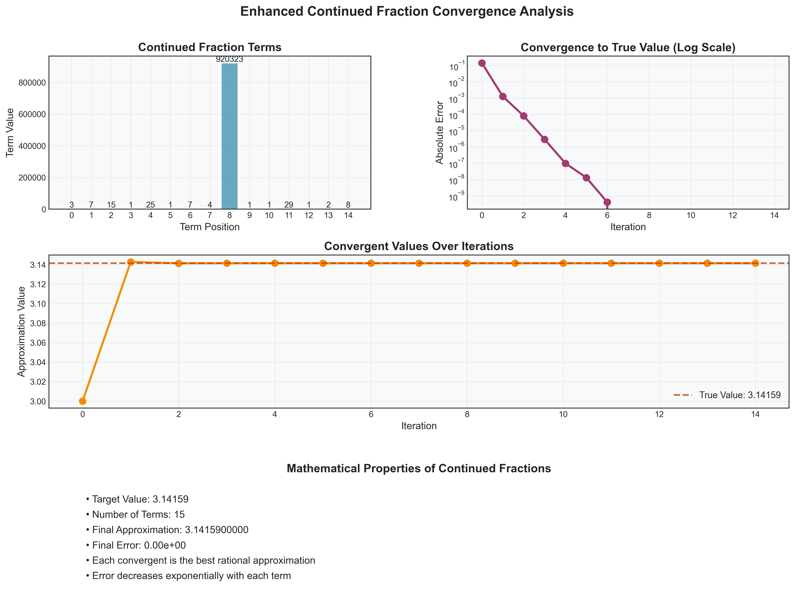
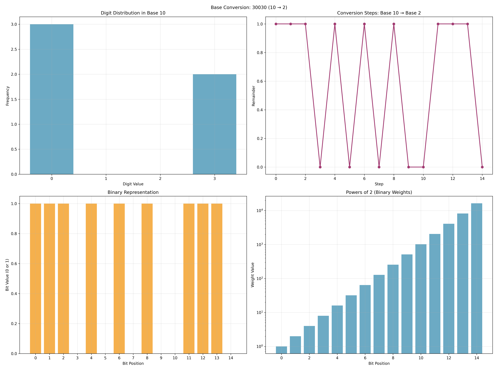
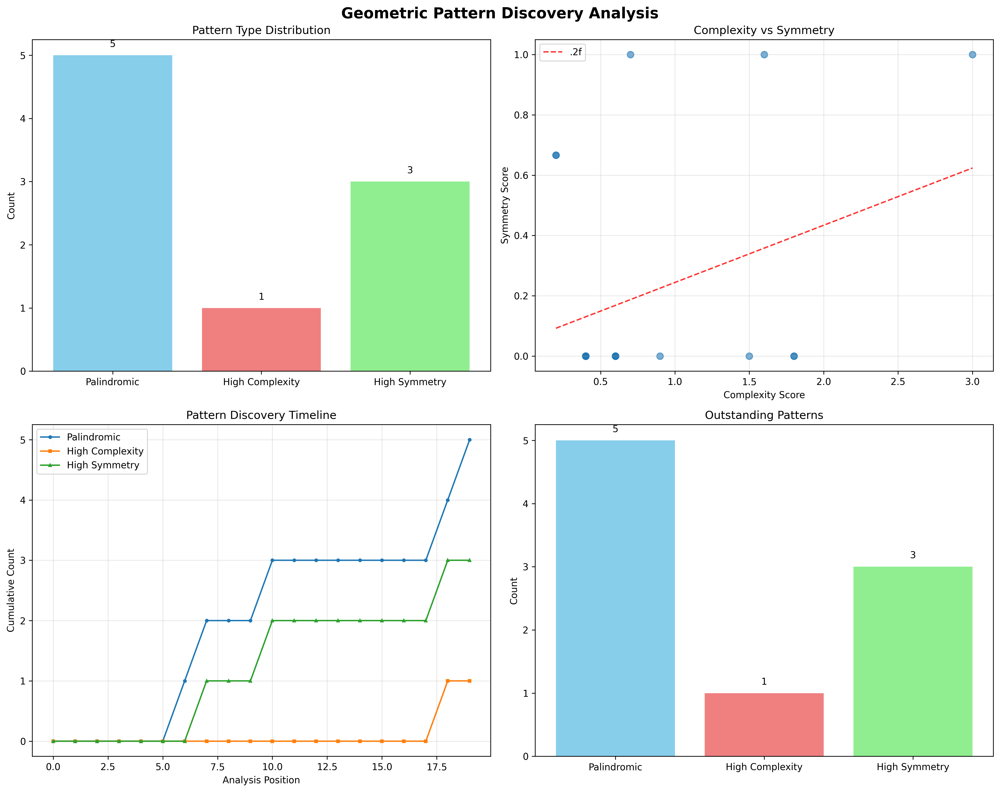

## Computational Methods

### Algorithm Design Principles

Specify the numeric domain, operation and output representation separately.
Exact rational arithmetic avoids rounding in rational algebra, but neither
eliminates input uncertainty nor makes every algorithm exact or efficient.
The [API reference](../../docs/api/index.md) owns signatures and supported inputs.

### Exact Rational Arithmetic Implementation

`SymergeticsNumber` wraps `fractions.Fraction`, which reduces rational results.
Integer powers and perfect rational roots remain exact; genuinely irrational
roots/powers use bounded-denominator approximations. `from_float` rationalizes
an already rounded binary input. Complexity depends on operand bit lengths,
integer multiplication and fraction reduction; it is not uniformly O(log n)
for all basic arithmetic. Source: [numbers.py](../../symergetics/core/numbers.py).

### Quadray Coordinate System Algorithms

The default forward embedding is the linear scale-1 map defined in
[foundations](03_mathematical_foundations.md#quadray-coordinate-system).
Common offsets cancel. `from_xyz` solves the nearest integer quadray-site
problem: regular tetrahedral embeddings use a BCC path; skew embeddings use
bounded closest-vector enumeration in rank three. It is not simple
componentwise inverse rounding or a guaranteed lossless continuous round trip.
A fixed count of coordinate operations does not imply constant bit complexity.
Source: [coordinates.py](../../symergetics/core/coordinates.py).

### Volume Calculation Algorithms

`integer_tetra_volume` takes an exact 3×3 determinant of quotient displacements
and returns abs(det)/4. Polyhedron measurements use declared indexed triangle
fans and live vertices. Nested shells use even–odd enclosed mass, not a convex
hull or a constant selected by class name. Closed orientable nonintersecting
shells are required; do not infer general intersection detection. Source:
[polyhedra.py](../../symergetics/geometry/polyhedra.py).

### Scheherazade Number Analysis

`scheherazade_power(n)` computes 1001^n. Binomial coefficients can be read in
three-digit blocks only while no coefficient reaches 1000; the coefficient
helper checks that condition against the actual digits. The binomial theorem
explains this pattern without a claim of new empirical discovery.

### Primorial Sequence Computation

`primorial(n)` generates primes up to the bound n and multiplies them. Thus
`primorial(13)` is 30,030, while `primorial(6)` is 30. A sieve's operation count
must be distinguished from growing-integer multiplication cost and memory.
Source: [primorials.py](../../symergetics/computation/primorials.py).

### Advanced Pattern Recognition

[Palindrome utilities](../../symergetics/computation/palindromes.py) inspect
specified representations. A decimal palindrome need not remain palindromic in
another base. Counts, density, logs or entropy-like summaries must be interpreted
according to their actual definitions; they are not automatically exact rational
statistics, scientific discoveries or security measures.

### Performance Optimization

No benchmark or general speed/memory advantage is reported here. Earlier
`MemoryEfficientCalculator` and `ParallelPatternAnalyzer` narratives were not
implemented contracts and are removed. A future performance study must state
input sizes/bit lengths, task, baseline, environment and repeated measurements.

### Implementation Architecture

See the [source map](04_system_architecture.md#package-structure) rather than
copying another set of module or API names.

**Figure 3**: Continued-fraction analysis for the finite input labeled 3.14159. Convergents can be exact rational values while approximating that input; a finite decimal approximation is not π itself, and float display does not certify arbitrary precision.

**Figure 4**: Base conversion of 30,030, the product of the first six primes and the prime-bounded primorial 13#. Integer base conversion preserves the integer but can change its digit-pattern properties.

**Figure 5**: Mathematical example summaries generated by the pattern-analysis workflow. Such panels describe selected input sequences and chosen statistics, not independent evidence of universal patterns, physical laws or superiority to floating-point methods.

### Visualization and Representation Methods

Finite-precision plotting is a presentation boundary. Retain exact values in
source data or metadata when needed and use labels that distinguish native
volume, embedding length and dimensionless ratios. A picture cannot establish
algorithmic correctness.

### Performance Optimization and Error Handling

Error handling is function-specific. Exact representation cannot correct invalid
models, invalid surfaces, division by zero, resource exhaustion or measurement
error. Use source contracts rather than claiming universal error recovery.
