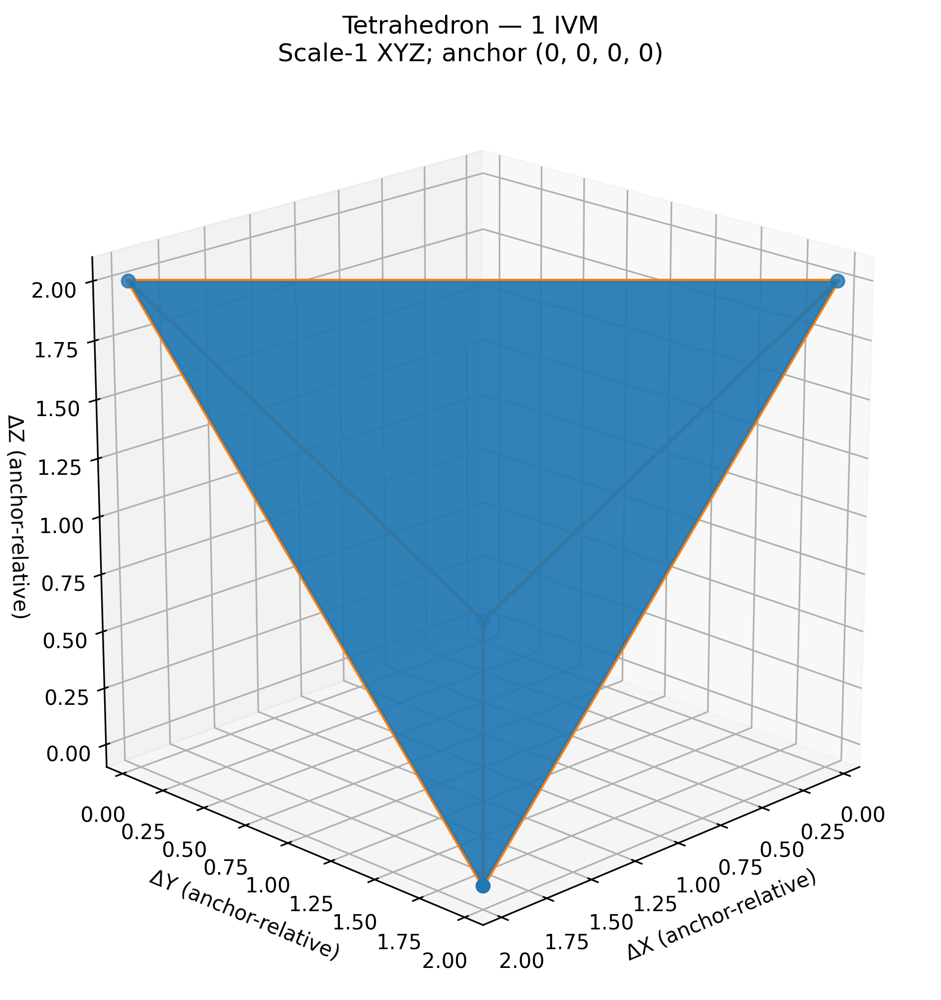
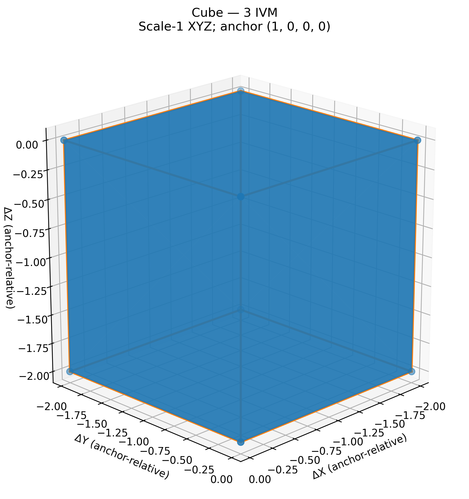

## Geometric Applications

### IVM Coordinate System for Precise Geometric Analysis

Quadray coordinates are useful for expressing tetrahedral symmetry and lattice
geometry. They do not add a physical dimension or make computations possible
that exact Cartesian methods cannot represent. The four integer slots have a
common-offset gauge; their scale-1 map and the distinction between BCC integer
image and FCC/IVM neighbors are defined in
[foundations](03_mathematical_foundations.md#quadray-coordinate-system).

### Exact Volume Calculations for Platonic Solids

The implemented classes are tetrahedron, cube, octahedron and cuboctahedron
(the last is not Platonic). Their default native volumes are 1, 3, 4 and 20 at
their specified relative sizes. No exact icosahedron/dodecahedron class is
provided by [polyhedra.py](../../symergetics/geometry/polyhedra.py).

For a tetrahedron the exact determinant formula returns a `Fraction`, not
necessarily an integer. General solid volume uses declared indexed triangle
fans with closed orientable nonintersecting shell preconditions. It is not a
convex-hull estimate or a structural-stability test. See
[unit and shell conventions](03_mathematical_foundations.md#isotropic-vector-matrix-ivm-units).

**Figure 6**: Rendered tetrahedral geometry. The default model has four triangular faces, native volume 1 and scale-1 Cartesian edge 2√2; the drawing is a finite-precision presentation rather than a proof of those quantities.

**Figure 7**: Rendered cube geometry with six square face cycles. The default cube has native volume 3 at its declared scale; this is not an assertion that an arbitrary cube has that volume or that equal-edge cube/tetrahedron volumes have ratio 3.

### Coordinate System Transformations

The default forward embedding uses integer coefficients, not square roots of
3 or 6, and requires no zero component sum. Float-returning views have finite
range and precision. The inverse selects a nearest integer lattice site and
therefore quantizes general continuous data. Preserve original observations and
record the snapping/scale policy before using it for measured geometry.
Source: [coordinates.py](../../symergetics/core/coordinates.py).

Plane projection uses exact represented rational normal/point values before
one nearest-lattice snap; quantization can move the result off the plane.
`reflect` accepts named basis-normal planes or origin inversion, not an arbitrary
normal argument. Polyhedron transforms call `with_vertices`, preserving concrete
type and indexed topology with an owned new vertex list; other state remains
shallow-shared unless subclasses override the protocol. Continuous inverse
matrices and exact nearest-site conversion remain distinct.

### Advanced Geometric Analysis Tools

Distinguish exact squared metric, generally irrational length/area, exact
vertex mean and exact uniform-solid centroid. Sampling vertices more densely
can change their mean without changing the intended solid's mass distribution.
Use the [API reference](../../docs/api/index.md) for supported operations; this
manuscript does not introduce `GeometricAnalyzer` or `PatternRecognizer` APIs.

### Visualization and Representation Methods

Plotting converts geometry to display coordinates. Declared topology determines
which vertices share edges/faces; connecting every pair would not represent a
solid's edge graph. Labels should identify embedding scale, native versus
Cartesian units and vertex versus mass centers. Supported format/render options
are function-specific, not a promised universal plotting-class interface.

### Applications in Research and Design

Architecture and materials studies could consume these primitives, but stress,
fatigue, buckling, crystal refinement and mechanical stability require separate
models and evidence. No architectural, crystal-structure or engineering analyzer
is supplied by this section. See the
[application scenarios](../../docs/case-studies-real-world-applications.md).

### Implementation and Examples

Use [actual source contracts](../../docs/api/index.md) and the
[example map](../../docs/examples/index.md) rather than hypothetical domain
classes. A volume demonstration establishes neither design safety nor empirical
benefit.
