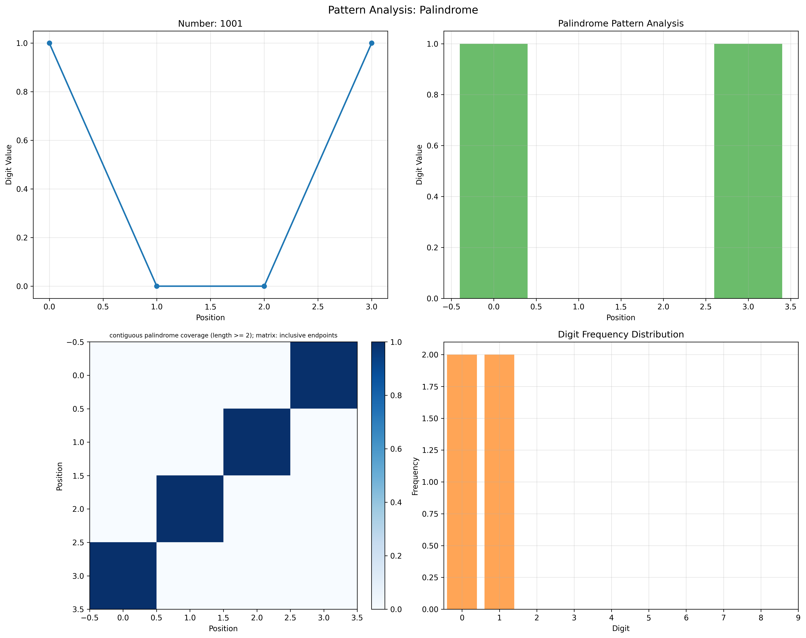
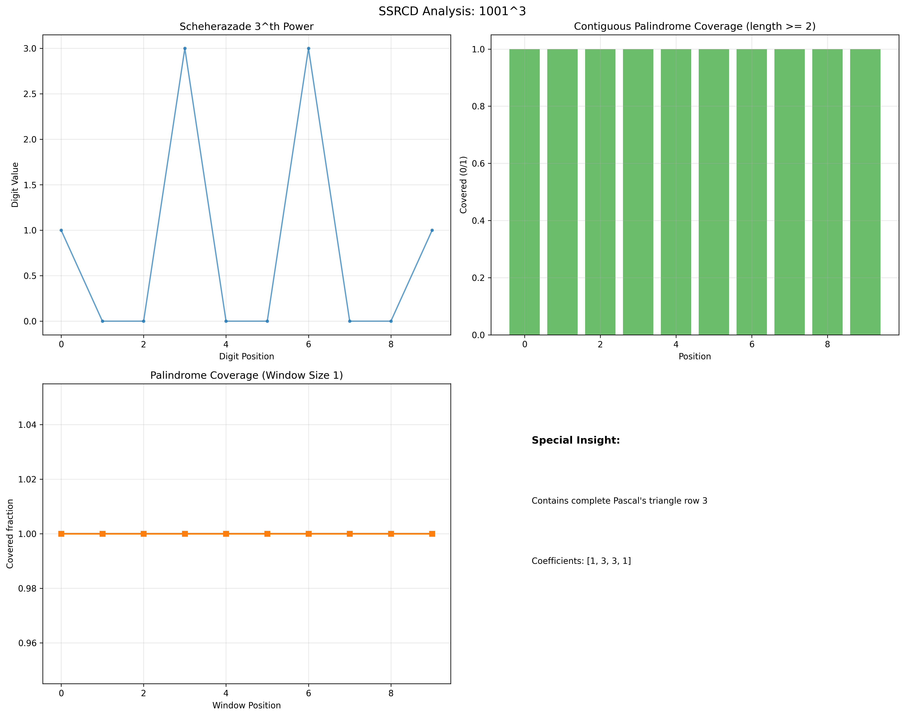
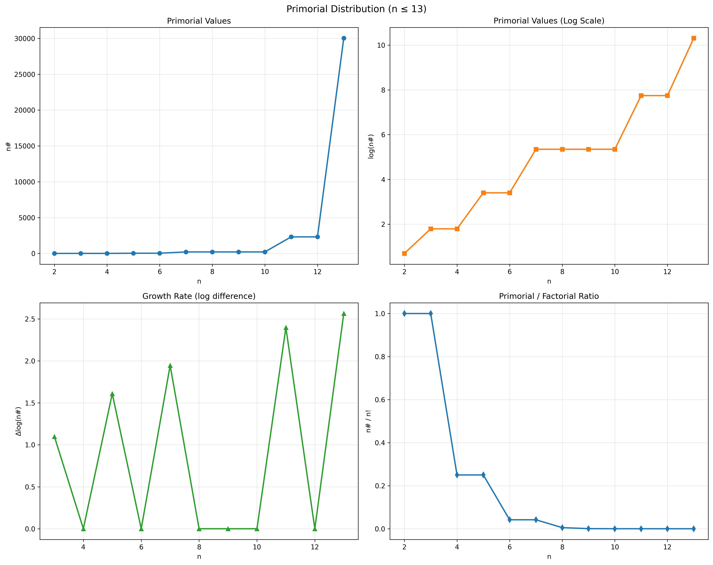

## Pattern Discovery

### Mathematical Pattern Recognition Framework

The implemented utilities examine selected integer sequences and digit
representations. “Discovery” here means inspecting those inputs, not finding
all possible patterns or proving novel number theory. Exact integers preserve
digits, but established integer and symbolic tools can do so too. No comparative
accuracy advantage over other methods is established.

### Scheherazade Number Pattern Analysis

For nonnegative integer n, the binomial theorem expands 1001^n = (10³+1)^n.
While all coefficients C(n,k) are below 1000, their zero-padded three-digit
blocks concatenate to the decimal integer. Once carries occur, that direct
reading fails. `scheherazade_pascal_coefficients` checks the coefficient bounds
and digits; `scheherazade_power` computes the power itself rather than running
a universal pattern detector. Source:
[primorials.py](../../symergetics/computation/primorials.py).

### Primorial Sequence Analysis

The implemented prime-bounded primorial is n# = product of primes p ≤ n.
The first-six-primes product 30,030 is therefore `primorial(13)`, not
`primorial(6)`. Exact prime products are mathematical computations, not evidence
that a new connection to the Riemann zeta function has been established.
Growth claims must state whether the independent variable is a prime bound,
prime index or bit length.

### Advanced Palindrome Detection

A palindrome is a property of a representation. A number can be palindromic in
one base but not another; selected substrings need not imply a palindrome of the
entire integer. Counts/densities need an explicit interval and definition.
Numerical entropy-like summaries are not generally exact rational information
measures. See [palindromes.py](../../symergetics/computation/palindromes.py).

The plotting API distinguishes raw-string palindrome coverage from the
computation module's odd-center density. Leading zeros remain part of the raw
input. Radar axes are fractions (digit diversity, normalized entropy, repeated
digit/bigram membership, contiguous-palindrome coverage and equal mirror pairs),
not counts clipped into a common radial range. Scalar coverage is linear; the
default returned relation matrix has quadratic size, with explicit matrix-free
ASCII mode available. See [method definitions](../../docs/api/index.md#mathematical-visualizations).

### Large Number Pattern Analysis

Arbitrary-precision integers avoid fixed-width overflow but do not provide
unbounded time or memory. Large searches and string conversion can be expensive.
This manuscript claims no `LargeNumberAnalyzer`, `PatternComplexityAnalyzer`,
parallel pattern service or automatic memory-budget API.

The selected sequence summary appears once as Figure 5 in the
[computational-method implementation section](05_computational_methods.md#implementation-architecture).
Its generating formulas and statistics are not independent evidence of a universal law.

**Figure 8**: Raw decimal sequence `1001`, with contiguous palindrome coverage for lengths ≥ 2, including even-length intervals. All four positions are covered; the matrix marks inclusive endpoint pairs (0,3) for `1001` and (1,2) for `00`, symmetrically. The bar heights are the covered digit values, so the two covered zeros have zero height. This is not the core odd-center matched-pair density metric or a representation-independent measure of physical symmetry.

**Figure 9**: Exact `1001**3 = 1003003001 = (1000 + 1)**3`. Its base-1000 blocks `1 | 003 | 003 | 001` encode the binomial coefficients [1,3,3,1] without carry between blocks. Such block interpretation requires coefficients smaller than 1000; selected digit patterns are not evidence of biological, physical or financial regularities.

**Figure 10**: Prime-bounded primorials for integer bounds 2 through 13: `n#` multiplies primes ≤ n, not the first n primes. Plateaus occur at composite bounds; `13# = 2×3×5×7×11×13 = 30030`. Exact integer products remain distinct from the finite-precision plotted values, logarithms and factorial ratios.

### Pattern Discovery Results

1001² = 1,002,001 and 13# = 30,030 illustrate known arithmetic. The figures
are retained as referenced generated artifacts and may predate current editable
sources; this section does not report newly regenerated images or independent
replication. There is no new benchmark, conjecture proof or domain dataset here.

### Implementation Architecture

The [API reference](../../docs/api/index.md) maps actual callable operations.
The [source map](04_system_architecture.md#package-structure) avoids references
to nonexistent pattern/complexity/optimization modules.

### Applications and Research Value

These utilities support exploration and teaching. Turning a selected pattern
into a scientific association requires a defined hypothesis, null model,
multiple-search controls and held-out evidence. It is not by itself a validated
cryptographic attack, anomaly detector or new theory.

### Performance and Scalability

No distributed processing, massive-data throughput or optimal complexity is
established here. Report input lengths, bit sizes, search limits and measured
time/memory before claiming scalability.
